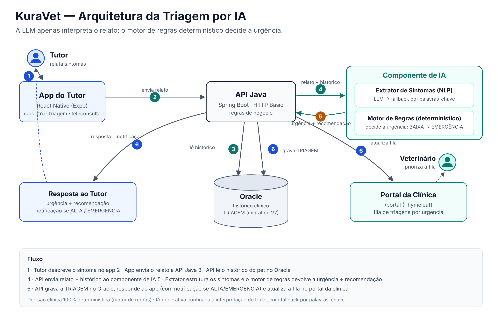

## 👥 Integrantes

* **Pedro Henrique Luiz Alves Duarte** — RM563405
* **Henrique Martins Oliveira** — RM563620
* **Guilherme Macedo Martins** — RM562396

**Disciplina:** DISRUPTIVE ARCHITECTURES: IOT, IOB & GENERATIVE IA (FIAP) — Turma 2TDSPO

## 🔗 Links Oficiais

* **Vídeo Pitch da Solução:** 
* **Repositório GitHub:** https://github.com/KuraVet-Challenge-2026/iot-generative-ia

---

## 1. Definição do Problema e Proposta de Valor

O mercado veterinário brasileiro atua predominantemente de forma episódica: o tutor aciona a clínica apenas em emergências ou para vacinas obrigatórias. Isso resulta em uma jornada de saúde fragmentada, baixa recorrência, enfraquecimento do vínculo entre clínica e tutor, e um baixo *Lifetime Value* (LTV) por animal. O componente de IA do KuraVet transforma dados isolados em uma jornada de cuidado contínuo e preventivo.

A inteligência artificial agrega valor aos seguintes atores:

* **Para o Tutor:** elimina a carga mental do cuidado diário. A IA cruza espécie, idade e histórico clínico para orientar sobre a urgência de sintomas relatados, sem exigir o preenchimento de formulários complexos.
* **Para a Clínica:** otimiza o tempo da equipe. A IA classifica a urgência dos sintomas relatados e organiza a fila de triagem no portal, permitindo priorizar os casos mais graves.
* **Para o Pet:** favorece a identificação precoce de situações de risco, respeitando as particularidades de cada fase biológica.

## 2. Abordagem de IA (Justificativa Tecnológica)

Adotamos uma **abordagem híbrida** que combina um **motor de regras determinístico** com uma **LLM** usada apenas para **Processamento de Linguagem Natural (NLP)**.

* **Motor de regras determinístico (decisão clínica):** no setor de saúde, a decisão de urgência não pode depender de um modelo generativo sujeito a alucinações. O motor de regras cruza os sintomas extraídos com espécie, idade e histórico do pet (Oracle) e decide a urgência — `BAIXA | MODERADA | ALTA | EMERGENCIA` — e a recomendação, de forma auditável e reproduzível.
* **LLM para NLP (interpretação do relato):** a LLM atua estritamente na camada de comunicação. Recebe o relato informal do tutor em linguagem natural e o converte em sintomas estruturados (JSON com schema fixo). **Ela não decide a urgência** — apenas estrutura o texto para o motor de regras.
* **Fallback sem LLM:** quando a LLM não está disponível (ou o provedor ainda não está configurado), um **extrator por palavras-chave** garante que a triagem continue funcionando. O sistema é utilizável mesmo sem a camada generativa.

> **Por que isso importa:** a parte que toma a decisão clínica é 100% determinística e explicável. A IA generativa fica confinada à interpretação de texto, onde um erro é recuperável e nunca compromete a classificação de risco.

## 3. Mapeamento de Dados (IoB)

| **Dado** | **Origem** | **Estrutura** | **Utilização pela IA** |
| --- | --- | --- | --- |
| **Perfil do Pet** (espécie, raça, idade, peso) | Cadastro do tutor no App | Estruturado (relacional/JSON) | Define limites biológicos para o motor de regras avaliar o risco. |
| **Histórico Clínico** | Inserido pelo veterinário no portal web, retido no Oracle | Estruturado (relacional) | Fornece contexto (doenças crônicas, cirurgias) para precisão na classificação. |
| **Relatos de Sintomas (IoB)** | Texto livre inserido pelo tutor no App | Não-estruturado (texto) | A LLM (ou o fallback por palavras-chave) extrai os sintomas que alimentam o motor de regras. |

## 4. Arquitetura e Fluxo de Dados

1. O tutor insere um relato de sintoma no app (React Native / Expo).
2. A requisição vai para o backend, uma API em **Java (Spring Boot)** — autenticação via **HTTP Basic**.
3. A API consulta o **Oracle** para resgatar o histórico do pet.
4. A API monta o contexto (relato + histórico) e aciona o componente de IA.
5. O **extrator de sintomas** (LLM ou fallback por palavras-chave) estrutura o relato; o **motor de regras** avalia o risco e devolve a classificação de urgência e a diretriz clínica.
6. A API grava a triagem no Oracle e, em paralelo, retorna o resultado ao app e atualiza a **fila de triagem no portal da clínica** (`/portal`). Casos `ALTA`/`EMERGENCIA` geram notificação no app.

### Diagrama de Arquitetura



## 5. Onde está o código

A lógica de IA é implementada **dentro do backend Java** (repositório `java-advanced`, pacote `br.com.fiap.kuravet.ia`), porque é onde estão os dados (Oracle) e o deploy. **Este repositório documenta e evidencia a IA:**

```
README.md                      # este arquivo
prompts/extracao_sintomas.md   # prompt de sistema + schema JSON de saída da extração
regras/tabela_regras.md        # regras de urgência (sintoma × espécie × idade → urgência)
avaliacao/cenarios.csv         # relatos de teste com a urgência esperada
avaliacao/resultados.md        # esperado × obtido, taxa de acerto e casos de fallback
```

> Os diretórios `prompts/`, `regras/` e `avaliacao/` são preenchidos conforme a triagem é implementada e validada no `java-advanced`.

## 6. Como Testar

A triagem é exposta pela API Java (endpoint de triagens) e consumida pela tela de triagem do app e pela fila do portal.

* **Pelo app / portal:** acessar a aplicação em `<URL_DO_WEB_APP>` *(preencher quando o deploy na Azure estiver no ar)*, enviar um relato de sintoma e observar a urgência e a recomendação retornadas.
* **Pela API:** enviar o relato ao endpoint de triagem com autenticação **HTTP Basic**. O contrato de request/response está documentado no `java-advanced` e em `prompts/extracao_sintomas.md`.
* **Cenários de validação:** os casos de teste e seus resultados (esperado × obtido) ficam em `avaliacao/`.

## 7. Tecnologias Utilizadas

* **App do Tutor:** React Native (Expo). Autenticação na API via HTTP Basic.
* **Backend e Portal Web:** Java 21 + Spring Boot, endpoints REST (JSON) e portal do veterinário/tutor em Thymeleaf (`/portal`). Migrations versionadas com Flyway.
* **Banco de Dados:** Oracle (instância da FIAP).
* **Inteligência Artificial:** motor de regras determinístico (decisão de urgência) + LLM para NLP na extração de sintomas, com fallback por palavras-chave.
* **Deploy:** Azure Web App, via pipeline no Azure DevOps. Segredos (incluindo `LLM_API_KEY`) injetados por *Variable Group* — nunca versionados no repositório.

## 8. Resultados Parciais

* Arquitetura da triagem híbrida definida e documentada (seção 2).
* Motor de regras e extração de sintomas por palavras-chave em implementação no `java-advanced` (migration `V7 TRIAGEM`).
* Integração com LLM condicionada à definição do provedor; até lá, o fallback por palavras-chave mantém a triagem funcional.
* Avaliação por cenários (esperado × obtido) em `avaliacao/`.

## 9. Limitações

* A triagem **não substitui a avaliação veterinária**: é uma ferramenta de priorização, não de diagnóstico.
* A camada de LLM é opcional; sem provedor configurado, a extração usa o fallback por palavras-chave, que cobre um conjunto menor de relatos.
* A precisão do motor de regras depende da completude do histórico do pet no Oracle.
